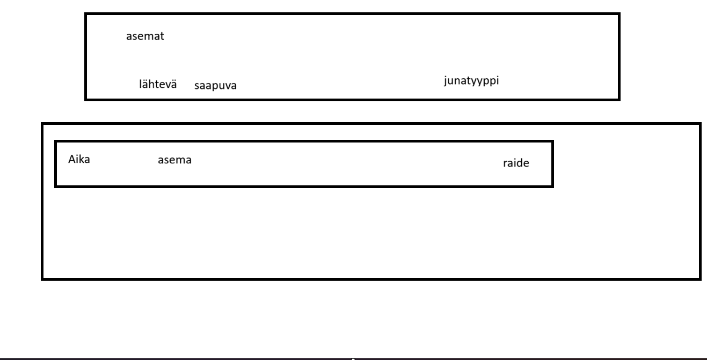
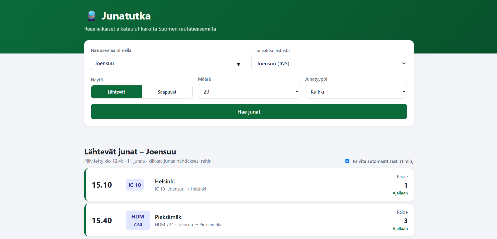

# Junatutka 🚆

- **Tekijä:** Arttu Laine

## Projektisuunnitelma

- **Projektin idea:** Junatutka on verkkosovellus, josta näkee minkä tahansa Suomen rautatieasemien lähtevät ja saapuvat junat reaaliajassa. Sovellus on tarkoitettu junalla matkustaville, jotka haluavat tarkistaa nopeasti seuraavat junat, raiteet ja mahdolliset myöhästymiset.

- **Suunnitellut toiminnot:**
  1. Aseman valinta pudotusvalikosta tai haku omalla hakusanalla (ehdotuslista kirjoittaessa)
  2. Lähtevien / saapuvien junien näyttäminen: aika, arvioitu aika, linja, määränpää, raide ja tila (ajallaan / myöhässä / peruttu)
  3. Suodatus junatyypin (lähi/kaukojunat) ja määrät
  4. Junan koko reitin näyttäminen klikkaamalla junaa
  5. Automaattinen päivitys minuutin välein

- **Rautalankamalli / luonnos:**

  

## Verkkolinkit

- Julkaistu sovellus (Netlify): https://whimsical-kelpie-1d079d.netlify.app/
- GitHub-repositorio: https://github.com/arbertos/Projekti-2

## Tietoja sovelluksesta

**Junatutka** on verkkosovellus, joka hakee AJAX-kutsuilla (fetch) dataa Fintrafficin [Digitraffic-rautatierajapinnasta](https://www.digitraffic.fi/rautatieliikenne/). Data ei ole staattinen tiedosto, vaan live-palvelimen palauttamaa reaaliaikaista tietoa.

Sovelluksen kulku:
1. Sivun latautuessa haetaan asemalista (`/metadata/stations`), josta poimitaan Suomen rautatieasemat valikkoon ja hakukentän ehdotuksiin.
2. Kun käyttäjä valitsee aseman, haetaan aseman junat (`/live-trains/station/{asema}`). Vastaus tallennetaan muuttujaan, ja siitä valitaan vain tarvittavat tiedot (aseman aikataulurivi, määränpää, raide, myöhästyminen).
3. Valitut tiedot näytetään junakortteina. Myöhässä olevat ja perutut junat korostetaan värein.
4. Klikkaamalla junaa haetaan sen koko reitti (`/trains/{päivä}/{junanumero}`) ja näytetään se aikajanana.

Rajapinta ei vaadi API-avainta, joten sovellus toimii suoraan selaimessa ilman taustapalvelinta.

## Teknologiat

- **HTML:** sivun rakenne, lomake ja modaali
- **CSS:** ulkoasu, CSS-muuttujat, Grid- ja Flexbox-asettelu, responsiivisuus (media query)
- **JavaScript (natiivi):** AJAX-kutsut `fetch`- ja `async/await`-syntaksilla, datan käsittely (`filter`, `map`, `sort`), DOM-skriptaus, kaikki tapahtumankäsittelijät lisätään dynaamisesti `addEventListener`-metodilla (myös tapahtumadelegointi junalistassa)
- **Digitraffic REST API:** reaaliaikainen junadata JSON-muodossa

## Sovelluksen käyttö

1. Avaa sovellus selaimessa.
2. Kirjoita aseman nimi hakukenttään (esim. "Tampere") tai valitse asema pudotusvalikosta.
3. Valitse, haluatko nähdä lähtevät vai saapuvat junat, sekä halutessasi junatyyppi ja määrä.
4. Klikkaa junaa nähdäksesi sen koko reitin ja aikataulun. Lista päivittyy automaattisesti minuutin välein.

  ## Sovelluksen käynnistäminen paikallisesti
  1. Kloonaa tai lataa repositorio.
  2. Avaa projektikansio.
  3. Avaa `index.html` selaimessa (tai VS Coden Live Serverillä).

## Kuvakaappaukset

## Tunnetut virheet / puutteet

- Jos hakusana sopii usealle asemalle, valitaan ensimmäinen osuma (tarkka nimi tai lyhenne menee aina etusijalle).
- Jos rajapinta ei vastaa, näytetään virheilmoitus, mutta hakua ei yritetä automaattisesti uudelleen ennen seuraavaa päivitystä.
- Ei voi etsiä esim. Lähtevä asema ja eri saapumis asema niin kuin esimerkiksi vr sovelluksessa.
## Työn jakautuminen

Tehty yksilötyönä.

## Oma arvio ja oppimisen reflektointi

- **Mikä onnistui?** Perus HTML elementit ja css tyylit. onnistuin myös fetch kutsuissa. async/await, koodi odottaa vastausta jäätymättä ja käyttöliittymä toimii sillä välin.
- **Mikä oli haastavaa?** junanreittimoduuli, automaattinen päivitys, hakukentän ehdotuslista. Digitraficin junaobjekti on todella iso, jokaisella junalla on lista kaikista asemista ja sieltä pitää etsiä oikea asema. REST API:n käyttö. JSON datan käsittely.
- **Mitä parantaisin, jos aikaa olisi enemmän?** Tekisin siitä perinteisin juna haku sovelluksen missä voi valita lähtevän ja saapuvan aseman samaan aikaan.
- **Mitä opin HTML:stä, CSS:stä, JavaScriptistä ja DOM-skriptauksesta?** Fetch- kutsu ja ainahan näissä projekteissa oppii kaikkia pikku juttuja jotka sujuvoittaa tekemistä.
- **Mikä jäi epäselväksi / mistä haluaisin oppia lisää?** Miten isosta JSON vastauksesta löytää nopeasti oikeat kentät ilman pitkää kokeilua. 
- **Itsearvio:** 6/10 pistettä
- **Käytetty aika:** 6 tuntia

## Lähteet

- Data: [Fintraffic / Digitraffic](https://www.digitraffic.fi/rautatieliikenne/), lisenssi CC 4.0 BY
- [MDN Web Docs – Fetch API](https://developer.mozilla.org/en-US/docs/Web/API/Fetch_API)

- **Tekoäly:** Kirjoitin sovelluksen peruskoodin itse (HTML-rakenne, perustyylit ja fetch-kutsut). Claudea (Anthropic) käytin seuraaviin:
  - **Datan käsittely (`toDisplayRow`):** Claude kirjoitti logiikan, joka etsii junan reitiltä (`timeTableRows`) valitun aseman oikean aikataulurivin, karsii tavarajunat ja jo lähteneet junat ja poimii näytettävät tiedot (aika, arvioitu aika, myöhästyminen, raide, määränpää).
  - **Junan reittinäkymä (`openTrainRoute`)**
  - **Hakukentän ja pudotusvalikon synkronointi** sekä suodatuksen ja määrän yhdistäminen
  - **Automaattinen päivitys**